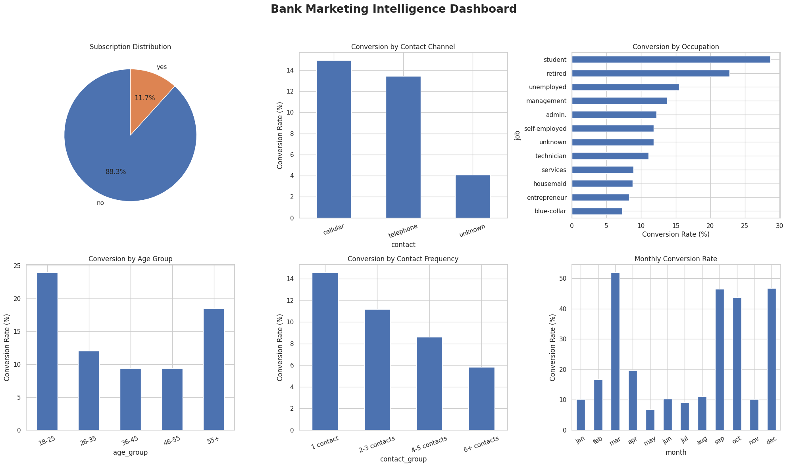

# Bank Marketing Intelligence & Campaign Effectiveness Analytics

A data analytics project exploring customer subscription behaviour and direct marketing campaign effectiveness in the banking sector using Python and MySQL.

## Project Overview

Banks use direct marketing campaigns to promote financial products such as term deposits. Understanding which customer segments are more likely to subscribe can help improve campaign targeting and resource allocation.

This project analyses historical bank marketing data to identify patterns in customer subscription behaviour, evaluate campaign performance and generate actionable business insights.

## Dataset

**Source:** [UCI Machine Learning Repository – Bank Marketing Dataset](https://archive.ics.uci.edu/dataset/222/bank+marketing)

- Dataset: `bank-full.csv`
- Total records: 45,211
- Original features: 17 (including the target variable)
- Target variable: `y` (whether the customer subscribed to a term deposit)
- Domain: Banking and Financial Services

The dataset contains customer demographics, financial information, contact details and historical campaign information.

## Tools & Technologies

- **Python:** Pandas, NumPy
- **Data Visualization:** Matplotlib, Seaborn
- **Database:** MySQL
- **SQL Concepts:** Aggregations, GROUP BY, HAVING, CTEs and Window Functions
- **Environment:** Google Colab, MySQL Workbench

## Project Workflow

1. Data loading and initial inspection
2. Data quality assessment and preprocessing
3. Exploratory Data Analysis (EDA)
4. Feature engineering and customer segmentation
5. SQL-based campaign performance analysis
6. Data visualization and dashboard development
7. Business insights and recommendations

## Key Business Questions

- What is the overall term-deposit subscription rate?
- Which occupations and age groups show higher subscription rates?
- How does subscription behaviour vary across contact channels?
- Does previous campaign success relate to current subscription?
- How does the number of contacts relate to conversion rates?
- Which months recorded comparatively higher subscription rates?

## Key Findings

| Analysis | Key Finding |
|---|---|
| Overall conversion | 11.70% |
| Contact channel | Cellular: 14.92% |
| Previous campaign success | 64.73% subscription rate |
| Occupation | Students: 28.68% |
| Age group | 18–25: 23.95% |
| Contact frequency | One contact: 14.60% |

These findings represent historical associations, not proof of causation.

## Dashboard

The project includes a Python-generated dashboard summarising campaign performance across customer segments and marketing characteristics.



## Repository Structure

```text
bank-marketing-campaign-analytics/
│
├── notebooks/
│   └── bank_marketing_analysis.ipynb
│
├── sql/
│   └── bank_marketing_analysis.sql
│
├── dashboard/
│   └── bank_marketing_dashboard.png
│
├── reports/
│
└── README.md
```

## Limitations

- The dataset is observational, so relationships cannot automatically be interpreted as causal.
- Campaign expenditure and revenue data are unavailable; therefore, ROI and customer acquisition cost cannot be calculated.
- Call duration is known only after a call and should not be used for pre-call targeting.
- Historical campaign patterns may not necessarily generalise to future campaigns.

## Conclusion

This project demonstrates the application of Python-based exploratory data analysis, feature engineering, SQL querying and data visualization to solve a practical marketing analytics problem.

It highlights how customer segmentation and campaign performance analysis can support more informed, data-driven marketing decisions.

## Author

**Prantik Dutta**  
MSc Statistics & Computing  
Banaras Hindu University (BHU)
